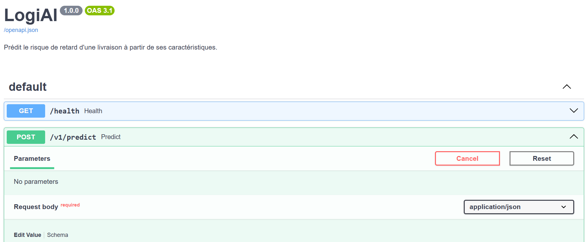
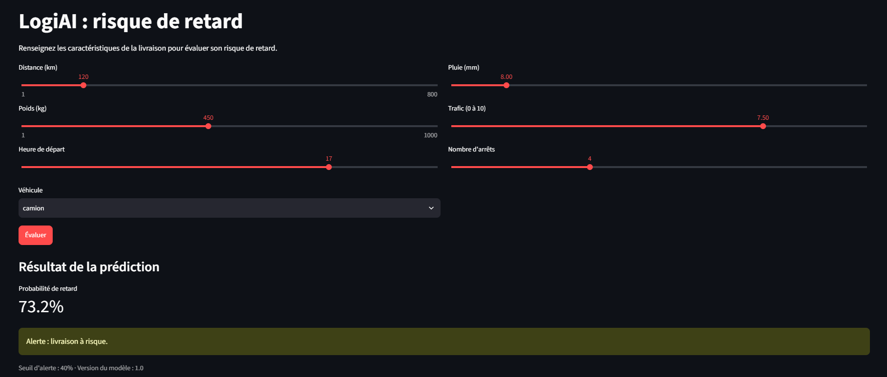

# Compte rendu : TP API LogiAI

**Noms :** Leila Souiri   **Groupe :** 3

## 1. Environnement et premiers tests
Le projet LogiAI a été développé avec Python. Il utilise FastAPI pour créer l’API REST, Pydantic pour valider les données reçues et un modèle de machine learning pour prédire les retards de livraison.

La génération du dataset a produit 5 000 livraisons, avec un taux de retard de 27,4 %. Après les corrections apportées au schéma et à la fonction predict(), l’exécution de python -m pytest a donné 13 tests réussis.

Résultat initial de python -m pytest :
(.venv) PS C:\Users\USER\Logiai_starter> python -m pytest
============================= test session starts ==============================
platform win32 -- Python 3.14.0, pytest-9.2.0, pluggy-1.7.0
rootdir: C:\Users\USER\Logiai_starter
plugins: anyio-4.15.1
collected 13 items                                                              

tests\test_api.py .......F.....                                           [100%]

=================================== FAILURES ===================================
________________________ test_pluie_impossible_refusee _________________________

    def test_pluie_impossible_refusee():
        with TestClient(app) as client:
>           assert post(client, pluie_mm=500).status_code == 422
E           assert 200 == 422
E            +  where 200 = <Response [200 OK]>.status_code
E            +    where <Response [200 OK]> = post(<starlette.testclient.TestClient object at 0x000002707BE98AF0>, pluie_mm=500)

tests\test_api.py:60: AssertionError
=============================== warnings summary ===============================
.venv\Lib\site-packages\fastapi\testclient.py:1
  C:\Users\USER\Logiai_starter\.venv\Lib\site-packages\fastapi\testclient.py:1: StarletteDeprecationWarning: Using `httpx` with `starlette.testclient` is deprecated; install `httpx2` instead.
    from starlette.testclient import TestClient as TestClient  # noqa

-- Docs: https://docs.pytest.org/en/stable/how-to/capture-warnings.html
=========================== short test summary info ============================
FAILED tests/test_api.py::test_pluie_impossible_refusee - assert 200 == 422
=================== 1 failed, 12 passed, 1 warning in 7.20s ====================
(.venv) PS C:\Users\USER\Logiai_starter> python -m pytest
============================= test session starts ==============================
platform win32 -- Python 3.14.0, pytest-9.2.0, pluggy-1.7.0
rootdir: C:\Users\USER\Logiai_starter
plugins: anyio-4.15.1
collected 13 items                                                              

tests\test_api.py .............                                           [100%]

=============================== warnings summary ===============================
.venv\Lib\site-packages\fastapi\testclient.py:1
  C:\Users\USER\Logiai_starter\.venv\Lib\site-packages\fastapi\testclient.py:1: StarletteDeprecationWarning: Using `httpx` with `starlette.testclient` is deprecated; install `httpx2` instead.
    from starlette.testclient import TestClient as TestClient  # noqa

-- Docs: https://docs.pytest.org/en/stable/how-to/capture-warnings.html
======================== 13 passed, 1 warning in 4.34s =========================
- Pourquoi certains tests qui attendent un 422 passent-ils déjà, alors que rien n'est écrit ?

FastAPI utilise automatiquement la validation des données déclarées dans le modèle Pydantic. Si une requête contient une valeur invalide, FastAPI renvoie une réponse HTTP 422 sans qu’il soit nécessaire d’écrire manuellement un contrôle dans chaque route.

## 2. Mon schéma
- Mes bornes et leur justification physique (une ligne par variable) :

| Variable | Min | Max | Pourquoi |
|---|---|---|---|
| distance_km | 1 | 1000 |Une livraison doit parcourir au moins 1 km et la distance maximale est limitée à 1000 km. |
| poids_kg | 0,1 | 1000 | Le poids doit être positif et correspondre à une charge maximale de 1000 kg. |
| heure_depart | 0 | 23 | L’heure de départ doit correspondre à une heure valide de la journée. |
| pluie_mm | 0 | 499,999 | Les précipitations ne peuvent pas être négatives et les valeurs égales ou supérieures à 500 mm sont rejetées. |
| trafic_index | 0 | 10 | L’indice de trafic est limité à une échelle de 0 à 10. |
| nb_arrets | 0 | 100 | Le nombre d’arrêts doit être un entier positif ou nul, limité à 100. |

## 3. Ma fonction predict()
La fonction predict() récupère le modèle chargé au démarrage de l’application. Si le modèle est absent, elle renvoie une erreur HTTP 503. Sinon, elle transmet les données validées au prédicteur et retourne le résultat.

Code utilisé dans logiai/api/main.py :

predictor = state.get("predictor")

if predictor is None:
    raise HTTPException(
        status_code=503,
        detail="Le modèle de prédiction n'est pas chargé."
    )

return PredictionOut(
    **predictor.predict(livraison.model_dump())
)

## 4. Quatre requêtes
| Requête | Code obtenu | Pourquoi |
|---|---|---|
| livraison normale | 200 | Les données sont valides et le modèle renvoie une prédiction. |
| distance_km = -5 | 422 | La distance est inférieure à la valeur minimale autorisée. |
| type_vehicule = "avion" | 422 | Le type de véhicule n’appartient pas aux valeurs autorisées. |
| modèle absent (supprimez models/ et relancez) | 503 | La prédiction est impossible car le modèle n’est pas chargé. |

## 5. Questions de compréhension
1. Pourquoi charge-t-on le modèle au démarrage et pas à chaque requête ?
Le modèle est chargé une seule fois au démarrage afin d’éviter de répéter une opération coûteuse à chaque requête. Cela réduit le temps de réponse et améliore les performances de l’API.
2. Qui écrit le contrôle « pluie <= 100 », et où est-il écrit ?
Dans notre implémentation, la règle de validation est définie dans le schéma Pydantic logiai/api/schemas.py, avec le champ pluie_mm. La limite réellement codée est pluie_mm < 500, et non pluie_mm ≤ 100. Les valeurs égales à 500 sont donc rejetées.
3. Différence entre 422 et 503 ?
422 Unprocessable Entity : les données envoyées par le client ne respectent pas les règles de validation.
503 Service Unavailable : le service ne peut pas traiter la demande, par exemple lorsque le modèle de prédiction n’est pas chargé.
4. Pourquoi une route `/v1/predict` plutôt que `/predict` ?
Le préfixe /v1 indique la version 1 de l’API. Il facilite la gestion de futures évolutions et permet de proposer une nouvelle version sans nécessairement casser les applications qui utilisent l’ancienne.
5. Que se passerait-il si la distance était déclarée `int` ?
La distance devrait être un nombre entier. Les valeurs décimales ne seraient plus acceptées comme des distances numériques valides de type float, ce qui limiterait la précision des données reçues.

## 6. Décision : modèle absent
Répondre 503 ou refuser de démarrer ? Qu'est-ce que chaque option fait perdre ?
Deux solutions sont possibles :
- Renvoyer une erreur 503 : l’application démarre même si le modèle est absent, mais les requêtes de prédiction échouent jusqu’à ce que le modèle soit disponible. Cela permet à l’API de signaler clairement le problème.
- Refuser de démarrer : l’application ne démarre pas si le modèle est absent. Le problème est détecté immédiatement, mais les autres fonctionnalités de l’API deviennent également indisponibles.
Dans notre implémentation, la fonction predict() renvoie une erreur 503 lorsque le prédicteur n’est pas disponible. Ce choix permet de signaler l’indisponibilité du modèle au moment de la requête.

## 7. Lien de la pull request
https://github.com/lolo952/Logiai_starter/commit/745ecd4456e8b84e9e7b10d054ab934f98438789

### Documentation de l'API

### Interface de prédiction

